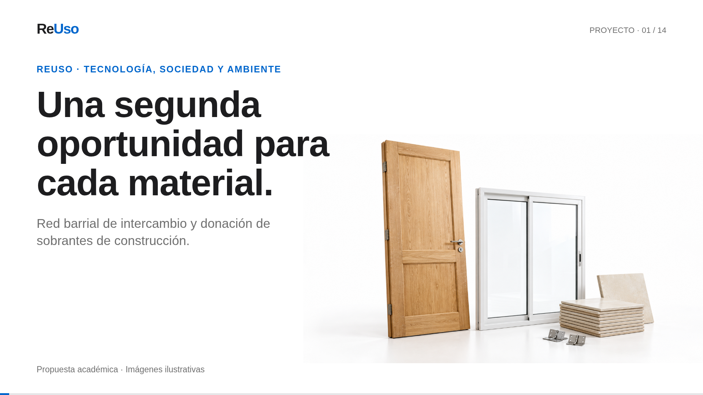

# ReUso — video narrado

**[Descargar el video MP4](./ReUso_Video_Narrado.mp4?raw=true)** · **[Descargar el proyecto editable](./ReUso_Remotion_Editable.zip?raw=true)**



Video explicativo del proyecto ReUso, creado con Remotion 4.0.539.

- Formato: MP4, 1920 × 1080, 30 fps, video H.264 y audio AAC.
- Duración prevista: 3 minutos y 47 segundos.
- Narración sintética en español, voz peninsular generada localmente con Piper.
- Catorce escenas: idea, funcionamiento, público, demostración, diagnóstico, ejes, leyes, cronograma, curso, herramientas, presupuesto, evaluación y propuesta empresarial.
- Las pantallas de la aplicación muestran ejemplos ficticios. Las encuestas, acuerdos y resultados del piloto siguen siendo propuestas.
- Diseño basado en DESIGN.md y en los documentos de ReUso preparados previamente.

## Archivos

- `ReUso_Video_Narrado.mp4`: video final para reproducir o presentar.
- `Guion_Video_ReUso.txt`: narración y marcas de inicio de las escenas.
- `ReUso_Remotion_Editable.zip`: proyecto fuente con imágenes y audios finales.
- `VOZ_FUENTE_Y_LICENCIA.txt`: procedencia de la voz y sus referencias.

## Editar o volver a exportar

Descomprimir el proyecto editable y abrir una terminal en esa carpeta. Requiere Node.js y npm:

```sh
npm ci
npm run preview
```

Los textos, imágenes y tiempos están en `composition_data.json`. El diseño y las animaciones están en `src/index.jsx`. Los archivos de `public/` son los recursos que utiliza el video.

```sh
npm run render
```

El MP4 aparecerá en `out/ReUso_Video_Narrado.mp4`. El render usa Chromium del sistema cuando existe en `/usr/bin/chromium`; en otro equipo Remotion puede descargar su navegador. También se puede configurar `REMOTION_BROWSER_EXECUTABLE` con la ruta de un navegador compatible.

El contenido está controlado por una plantilla y archivos JSON. Cambiar la narración requiere reemplazar el audio correspondiente y ajustar la duración de la escena, manteniendo el margen antes y después de la voz. No se incluyen los pesos del modelo de voz ni dependencias instaladas.

La elaboración utilizó IA como apoyo para guion, diseño, imágenes y voz sintética. La revisión y defensa académica del proyecto corresponden a sus integrantes.

## Escenas

- 00:00 — Una segunda oportunidad para cada material.
- 00:10 — Lo que sobra puede resolver otra necesidad.
- 00:23 — Tres formas simples de participar.
- 00:41 — Una comunidad acotada. Un inicio posible.
- 00:54 — Información suficiente para decidir.
- 01:11 — Primero escuchar. Después implementar.
- 01:28 — Tecnología con sentido social.
- 01:43 — Leyes vinculadas a decisiones concretas.
- 01:58 — Seis semanas para organizar, probar y evaluar.
- 02:14 — Aprender a participar con autonomía.
- 02:29 — Herramientas concretas. Responsables definidos.
- 02:50 — Un presupuesto explícito y revisable.
- 03:15 — Medir entregas útiles. Aprender y ajustar.
- 03:34 — Hacer posible el primer encuentro.
